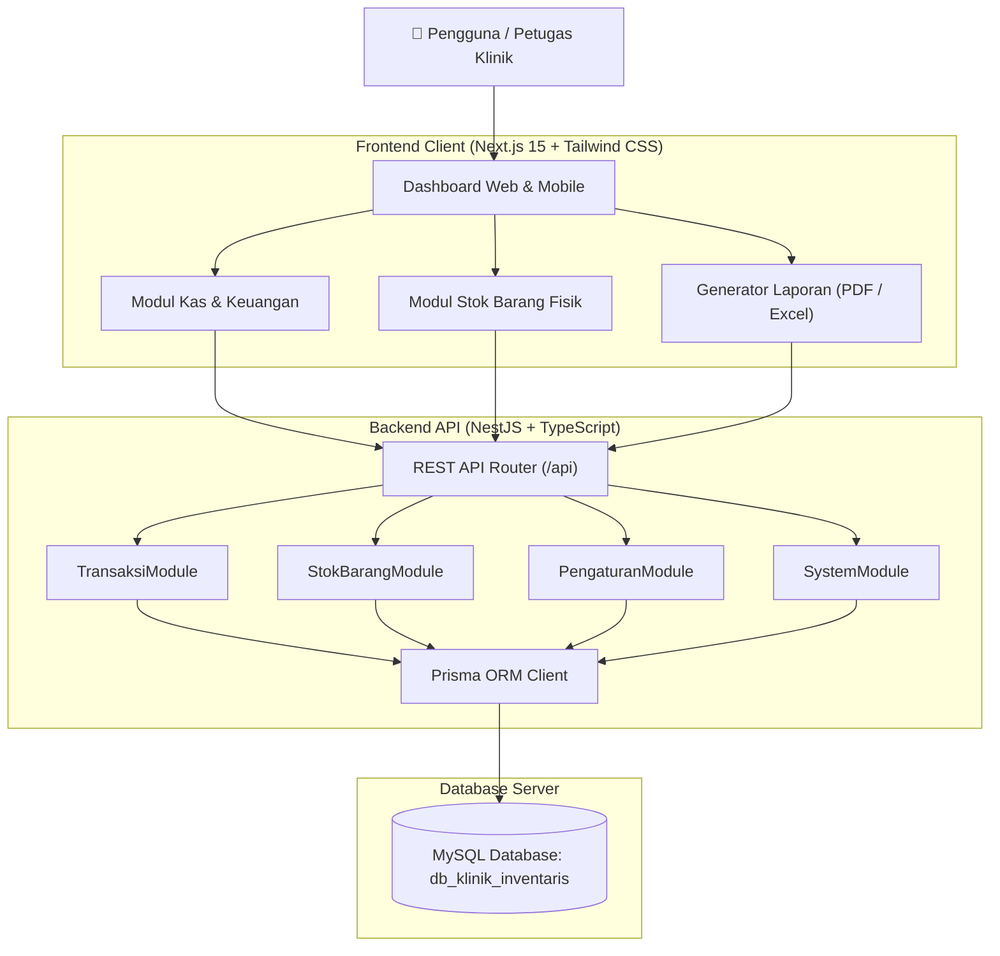
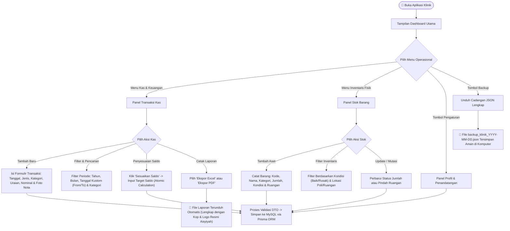

# 🏥 Sistem Informasi Inventaris & Laporan Keuangan Klinik
> **Klinik Pratama Aisyiyah Pangkajene**  
> Solusi digital modern untuk tata kelola aset klinik, pencatatan kas masuk & keluar, pelacakan bukti transaksi, serta penerbitan laporan dinas otomatis (Excel & PDF).

[](https://nestjs.com/)
[](https://www.prisma.io/)
[](https://nextjs.org/)
[](https://tailwindcss.com/)
[](https://www.mysql.com/)

---

## 📑 Daftar Isi
- [Arsitektur Sistem](#-arsitektur-sistem)
- [Alur Penggunaan (User Workflow)](#-alur-penggunaan-user-workflow)
- [Penjelasan Rinci Fitur Utama](#-penjelasan-rinci-fitur-utama)
- [Protokol Keamanan & Perlindungan Data (.gitignore)](#-protokol-keamanan--perlindungan-data-gitignore)
- [Struktur Direktori Monorepo](#-struktur-direktori-monorepo)
- [Panduan Instalasi & Menjalankan Lokal](#-panduan-instalasi--menjalankan-lokal)
- [Panduan Deployment di Server VPS](#-panduan-deployment-di-server-vps)
- [Lisensi & Pengembang](#-lisensi--pengembang)

---

## 🏛️ Arsitektur Sistem

Aplikasi ini menggunakan pola **Enterprise Monorepo**, memisahkan API backend berkinerja tinggi (*NestJS*) dan antarmuka pengguna responsif (*Next.js 15 App Router*) yang terhubung melalui REST API yang divalidasi penuh:



---

## 🔄 Alur Penggunaan (User Workflow)

Diagram alir berikut menggambarkan bagaimana petugas klinik mengoperasikan sistem dari awal login/akses hingga penerbitan dokumen laporan resmi:



---

## 🌟 Penjelasan Rinci Fitur Utama

### 1. 💰 Manajemen Kas & Keuangan (Pemasukan & Pengeluaran)
- **Kalkulasi Saldo Real-Time:** Menghitung saldo kas riil klinik secara otomatis (`Total Pemasukan - Total Pengeluaran`).
- **Kartu Statistik Finansial:** Kartu indikator interaktif yang merangkum Saldo Kas, Total Kas Masuk, dan Total Kas Keluar.
- **Pencatatan Rinci:** Mendukung input volume, satuan (Box/Unit/Pcs), harga satuan, dan nominal total.
- **Metode Pembayaran:** Pilihan pembayaran Tunai (*Kasir*) atau Transfer Bank.

### 2. 📸 Unggah & Lampiran Bukti Foto Nota
- **Kamera Smartphone & File Browser:** Mengunggah bukti kwitansi/nota pembelian langsung dari kamera handphone atau file galeri.
- **Preview Modal Instan:** Cukup klik ikon mata pada tabel transaksi untuk melihat foto nota dalam resolusi penuh tanpa perlu berpindah halaman.
- **Kompresi & Proteksi Ukuran:** Mendukung payload hingga 15MB dengan penyimpanan aman.

### 3. ⚖️ Fitur Sesuaikan & Reset Saldo Kas (Atomic Transaction)
- **Mode Penyesuaian Selisih (Disarankan):** Menghitung selisih antara saldo target dengan saldo buku saat ini, lalu menyisipkan 1 transaksi penyesuaian otomatis tanpa menghilangkan riwayat masa lalu.
- **Mode Reset Bersih:** Menghapus entri pemasukan lama dan menyetel saldo awal baru dengan tetap mempertahankan seluruh riwayat pengeluaran klinik.
- **Efek Konfeti UX:** Memberikan umpan balik visual animasi konfeti saat saldo berhasil diselaraskan.

### 4. 📦 Manajemen Inventaris & Stok Barang Fisik (Non-Kas)
- **Isolasi Penuh dari Kas:** Pencatatan aset, obat/BHP, alat medis, dan meubel yang sudah tersedia di klinik tanpa mempengaruhi arus kas operasional.
- **Pemantauan Kondisi Fisik:** Pelacakan kondisi barang: **Baik**, **Rusak Ringan**, dan **Rusak Berat**.
- **Pelacakan Lokasi:** Mengetahui posisi penempatan barang (Poli Umum, Farmasi, Laboratorium, Ruang Tunggu, Kasir, dll).
- **Statistik Barang:** Ringkasan jumlah seluruh unit barang, persentase barang siap pakai, dan barang yang memerlukan perbaikan.

### 5. 📑 Ekspor Dokumen Laporan Resmi (Excel & PDF)
- **Ekspor Excel (.xlsx via ExcelJS):**
  - **Logo Resmi Tersemat:** Gambar logo resmi Klinik Pratama Aisyiyah tertanam langsung di dalam lembar kerja Excel.
  - **Kop Surat & Identitas:** Alamat klinik, nomor telepon, dan email resmi pada bagian kop.
  - **Grouping Otomatis:** Baris dikelompokkan berdasarkan kategori dengan penghitungan subtotal per kategori dan grand total.
  - **Blok Tanda Tangan Resmi:** Tanggal penerbitan kota, tanda tangan Kepala Klinik (*lengkap dengan nomor SIP/NIP*), dan Pemegang Barang.
- **Ekspor PDF (.pdf via jsPDF + AutoTable):**
  - Tata letak dokumen resmi ukuran kertas A4 Portrait.
  - Garis ganda pembatas kop surat dinas.
  - Tabel dengan nomor urut berulang per kategori dan format mata uang Rupiah standar Indonesia.

### 6. ⚙️ Pengaturan Profil Klinik & Penandatangan Dinamis
- Mengubah nama klinik, alamat, kontak, kota penerbitan laporan, serta nama dan jabatan pejabat penandatangan tanpa perlu menyentuh baris kode (*no hardcoding*).

### 7. 💾 Cadangan Data Mandiri (1-Click JSON Backup)
- Mengunduh seluruh basis data transaksi, barang, dan pengaturan dalam 1 berkas JSON terstruktur untuk keamanan arsip klinik.

---

## 🛡️ Protokol Keamanan & Perlindungan Data (.gitignore)

Keamanan basis data dan kerahasiaan transaksi klinik diatur secara ketat melalui aturan `.gitignore` berlapis guna mencegah kebocoran kredensial ke repository publik:

### Proteksi Kredensial & Lingkungan
```gitignore
# Semua file environment lokal/VPS dicegah dari commit
.env
.env.*
.env.local
.env.development
.env.test
.env.production
*.env
**/.env
**/.env.*
**/.env.local
**/.env.production

# Hanya contoh template yang diizinkan masuk ke Git
!.env.example
!backend/.env.example
!frontend/.env.example
```

### Proteksi Sertifikat & Kunci Kriptografi
- Semua ekstensi kunci privat SSL/TLS (`*.pem`, `*.key`, `*.crt`, `*.pfx`, `*.p12`) diblokir total.
- Kunci SSH (`id_rsa*`, `id_ed25519*`) dicegah secara otomatis.
- File unduhan cadangan (`backup_*.json`, `*.dump`, `*.sql.gz`) tidak akan pernah ter-*push* ke git.

---

## 📂 Struktur Direktori Monorepo

```
Infentaris_klinik/
├── backend/                      # Service API NestJS + Prisma
│   ├── prisma/
│   │   └── schema.prisma         # Definisi skema tabel MySQL
│   ├── src/
│   │   ├── prisma/               # PrismaService koneksi database
│   │   ├── transaksi/            # Controller, Service, DTO Transaksi
│   │   ├── stok-barang/          # Controller, Service, DTO Stok Barang
│   │   ├── pengaturan/           # Controller, Service, DTO Pengaturan Klinik
│   │   ├── system/               # Endpoint /health & /backup
│   │   ├── app.module.ts         # Module agregator NestJS
│   │   └── main.ts               # Entrypoint, CORS, Pipe & Limit 15MB
│   ├── .env.example              # Template koneksi database
│   └── package.json
│
├── frontend/                     # Web App Next.js 15
│   ├── public/
│   │   ├── images/logo.png       # Logo resmi klinik
│   │   ├── manifest.json         # Konfigurasi PWA Mobile
│   │   └── sw.js                 # Service Worker offline cache
│   ├── src/
│   │   ├── app/
│   │   │   ├── layout.tsx        # Shell layout & metadata SEO
│   │   │   └── page.tsx          # Dashboard utama
│   │   ├── components/
│   │   │   ├── Navbar.tsx        # Navigasi & aksi cepat
│   │   │   ├── TransaksiView.tsx # Tabel kas & filter kustom
│   │   │   ├── StokView.tsx      # Tabel inventaris barang
│   │   │   ├── TransaksiModal.tsx# Form tambah/edit transaksi + upload foto
│   │   │   ├── StokModal.tsx     # Form tambah/edit barang
│   │   │   ├── ResetSaldoModal.tsx # Form penyesuaian saldo kas
│   │   │   └── PengaturanModal.tsx # Form identitas klinik & penandatangan
│   │   └── lib/
│   │       ├── api.ts            # Fetch wrapper REST API
│   │       ├── export-excel.ts   # Modul ekspor ExcelJS berlogo
│   │       ├── export-pdf.ts     # Modul ekspor PDF AutoTable
│   │       ├── logo-data.ts      # Aset Base64 logo resolusi tinggi
│   │       ├── types.ts          # Kontrak antarmuka TypeScript
│   │       └── utils.ts          # Formatter Rupiah & tanggal lokal
│   └── package.json
│
├── PANDUAN_MIGRASI_NESTJS_NEXTJS.md # Panduan teknis komprehensif VPS
├── database.sql                  # Skema database MySQL cadangan
├── package.json                  # Root orchestration script
└── .gitignore                    # Kebijakan proteksi keamanan repositori
```

---

## 💻 Panduan Instalasi & Menjalankan Lokal

### 1. Prasyarat Sistem
- **Node.js**: Versi 20.x atau 22.x LTS
- **Database**: MySQL Server aktif (port 3306)

### 2. Menjalankan Backend (NestJS)
```bash
cd backend
npm install --legacy-peer-deps

# Siapkan file konfigurasi .env
cp .env.example .env
# Sesuaikan DATABASE_URL di dalam file .env dengan user/password MySQL lokal Anda

# Sinkronkan skema tabel ke database
npx prisma db push

# Jalankan backend development
npm run start:dev
```
> Server backend akan berjalan di: `http://localhost:3001/api`

### 3. Menjalankan Frontend (Next.js)
Buka terminal baru:
```bash
cd frontend
npm install --legacy-peer-deps

# Jalankan frontend development
npm run dev
```
> Buka browser dan akses antarmuka web di: `http://localhost:3000`

---

## 🌐 Panduan Deployment di Server VPS

Untuk panduan instalasi di server VPS Ubuntu Linux menggunakan **PM2 Process Manager** dan **Nginx Reverse Proxy**, silakan ikuti petunjuk langkah-demi-langkah pada berkas:
👉 **[PANDUAN_MIGRASI_NESTJS_NEXTJS.md](PANDUAN_MIGRASI_NESTJS_NEXTJS.md)**

Ringkasan perintah PM2 di VPS:
```bash
# Jalankan Backend API
cd /var/www/inventaris-klinik/backend
pm2 start dist/main.js --name "klinik-api"

# Jalankan Frontend Web
cd /var/www/inventaris-klinik/frontend
PORT=3002 pm2 start npm --name "klinik-web" -- start

# Simpan proses
pm2 save
```

---

## 👨‍💻 Lisensi & Kepemilikan
Sistem ini dikembangkan khusus untuk operasional **Klinik Pratama Aisyiyah Pangkajene, Kabupaten Sidenreng Rappang, Sulawesi Selatan**. Seluruh hak cipta dilindungi.
